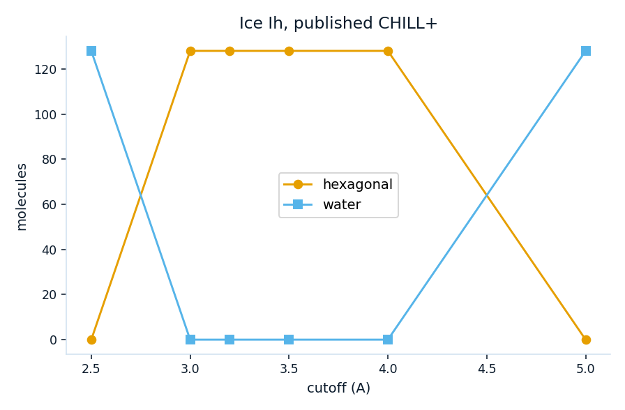

# Choose a cutoff

The cutoff is the neighbour shell, in angstrom. CHILL+, the rings, the cages, and q6 all read that shell. Too short, and a crystal looks like liquid. Too long, and the second neighbour shell floods the first and the labels collapse.

Ice Ih at 1 bar has an oxygen-oxygen contact near 2.75 angstrom. 3.5 angstrom sits past that contact and short of the next shell. The sweep below is the 128-oxygen cell `examples/inputs/ice1h.lammpstrj`.

=== "Python"

    ```python
    # example
    from pathlib import Path

    from dseams.userframe import read

    from examples.render import IH, WATER, panel, save

    frame = read("examples/inputs/ice1h.lammpstrj", atom_type=1)
    rows = []
    for cutoff in (2.5, 3.0, 3.2, 3.5, 4.0, 5.0):
        frame.cutoff = cutoff
        labels = frame.chill_plus()
        rows.append((cutoff, labels["hexagonal"], labels["water"]))
        print(cutoff, labels["hexagonal"], labels["water"])
    assert rows[0] == (2.5, 0, 128)
    assert rows[1][1:] == (128, 0)
    assert rows[3][1:] == (128, 0)
    assert rows[4][1:] == (128, 0)
    assert rows[5] == (5.0, 0, 128)

    chart, ax = panel()
    ax.plot([row[0] for row in rows], [row[1] for row in rows], color=IH, marker="o", label="hexagonal")
    ax.plot([row[0] for row in rows], [row[2] for row in rows], color=WATER, marker="s", label="water")
    ax.set_xlabel("cutoff (A)")
    ax.set_ylabel("molecules")
    ax.set_title("Ice Ih, published CHILL+")
    ax.legend()
    save(chart, Path("docs/images/figures/cutoff.png"))
    ```

=== "CLI"

    ```bash
    # example
    set -euo pipefail
    seams chill-plus examples/inputs/ice1h.lammpstrj --type 1 --cutoff 2.5 | tee /tmp/cut-25.txt
    grep -q "water 128" /tmp/cut-25.txt
    seams chill-plus examples/inputs/ice1h.lammpstrj --type 1 --cutoff 3.5 | tee /tmp/cut-35.txt
    grep -q "hexagonal 128" /tmp/cut-35.txt
    seams chill-plus examples/inputs/ice1h.lammpstrj --type 1 --cutoff 5.0 | tee /tmp/cut-50.txt
    grep -q "water 128" /tmp/cut-50.txt
    ```



At 2.5 angstrom the shell is empty of the contact and every molecule is water. From 3.0 through 4.0 angstrom the cell is entirely hexagonal. At 5.0 angstrom the extra neighbours wash the label out and the cell is water again. 3.5 angstrom is the default the tutorials use.

A confined sheet and a nanotube use the same shell. If the first peak of [g(r)](../tutorials/rdf.md) moves, move the cutoff with it, and check that a known crystal of that phase still classifies cleanly.
