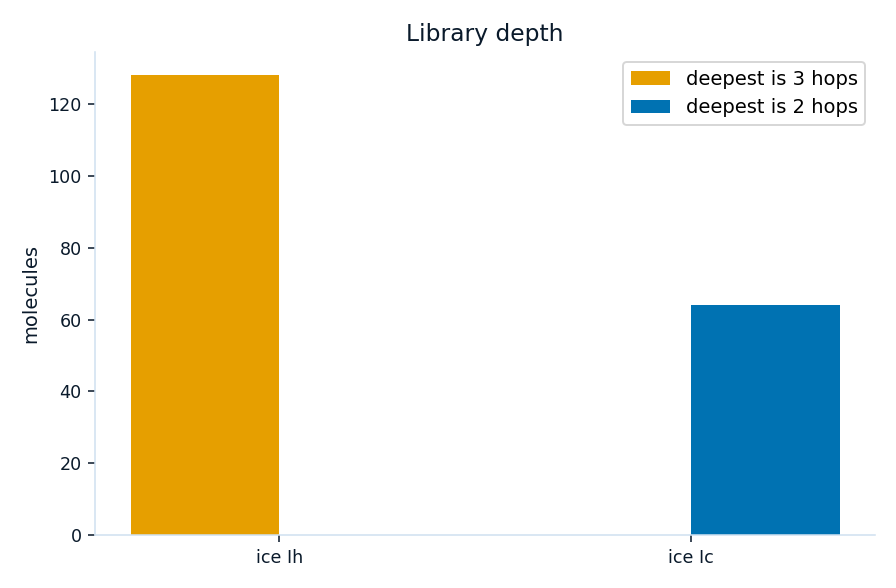

# Topology fingerprints

A fingerprint is the label-independent key of a bonded graph. Each atom contributes one rooted neighbourhood. The frame key covers the histogram of those neighbourhoods and the primitive-ring census. Two copies of the same bonded graph share that key after the atoms are renumbered.

Ice Ih and ice Ic are different graphs, so the frame keys differ. At two bonds from the centre the local class is still shared: both crystals are four-coordinated, and every atom of both cells falls in the class `0a14cfbf96ec99e0`. The ice Ih frame key at that depth is `9c7d00bca584a8ba` (128 atoms, 256 six-rings). The ice Ic key is `c8403f0bccb2e1d0` (64 atoms, 128 six-rings). At three bonds the classes split. A library written from ice Ih at three hops names all 128 atoms of the ice Ih cell and none of the ice Ic cell. A second library, written at two hops, still names the 64 ice Ic atoms. Given both files, each atom takes the deepest library that knows its key: depth 3 for ice Ih, depth 2 for ice Ic.

`--graph seeded` is two graphs. The fingerprint uses one, so that setting falls back to the cutoff list and the ice Ih key is unchanged. `--color-types` paints vertices by LAMMPS type, so two species never share a class. `--by-atom` adds one row per atom with the species, the coordination, the same-species bonds, and the primitive rings through that atom. On the ice Ih cell every row is coordination 4 and twelve six-rings.

The flag list is the [seams CLI reference](https://docs.dseams.info/reference/cli.html). A PLUMED run matches the same library files through `LIBRARY`, as in [On the fly with PLUMED](../tutorials/plumed.md). The column a viewer colours is in [Export labels](export.md).

=== "Python"

    ```python
    # example
    from pathlib import Path

    import numpy as np
    from pydseams import Frame

    from examples.render import IC, IH, panel, save

    ih = Frame.from_file("examples/inputs/ice1h.lammpstrj", atom_type=1)
    ic = Frame.from_file("examples/inputs/ice_ic.lammpstrj", atom_type=1)
    wide = ih.fingerprint(hops=2)
    assert wide.key == "9c7d00bca584a8ba"
    assert wide.method == "wl"
    assert wide.classes == {"0a14cfbf96ec99e0": 128}
    assert list(wide.ringCensus)[6] == 256
    assert ic.fingerprint(hops=2).key == "c8403f0bccb2e1d0"
    assert ic.fingerprint(hops=2).classes == {"0a14cfbf96ec99e0": 64}
    assert list(ic.fingerprint(hops=3).classes) == ["a537f4183e2a7d7d"]

    lib2 = ih.topology_library("Ih", hops=2)
    lib3 = ih.topology_library("Ih", hops=3)
    named_ih = ih.classify_topology([lib3, lib2])
    named_ic = ic.classify_topology([lib3, lib2])
    assert named_ih.matched == 128 and sorted(set(named_ih.depth)) == [3]
    assert named_ic.matched == 64 and sorted(set(named_ic.depth)) == [2]
    print(wide.key, named_ih.matched, named_ic.matched)

    chart, ax = panel()
    x = np.arange(2)
    ax.bar(x - 0.18, [128, 0], width=0.36, color=IH, label="deepest is 3 hops")
    ax.bar(x + 0.18, [0, 64], width=0.36, color=IC, label="deepest is 2 hops")
    ax.set_xticks(x, ["ice Ih", "ice Ic"])
    ax.set_ylabel("molecules")
    ax.set_title("Library depth")
    ax.legend()
    save(chart, Path("docs/images/figures/fingerprint.png"))
    ```

=== "CLI"

    ```bash
    # example
    set -euo pipefail
    seams fingerprint examples/inputs/ice1h.lammpstrj --type 1 --cutoff 3.5 --hops 2 | tee /tmp/fp-ih2.txt
    grep -q "key 9c7d00bca584a8ba" /tmp/fp-ih2.txt
    grep -q "method wl" /tmp/fp-ih2.txt
    grep -q "graph cutoff" /tmp/fp-ih2.txt
    grep -q "rings 3:0 4:0 5:0 6:256" /tmp/fp-ih2.txt
    seams fingerprint examples/inputs/ice1h.lammpstrj --type 1 --cutoff 3.5 --hops 2 --graph seeded | tee /tmp/fp-seeded.txt
    grep -q "graph cutoff" /tmp/fp-seeded.txt
    grep -q "key 9c7d00bca584a8ba" /tmp/fp-seeded.txt
    seams fingerprint examples/inputs/ice_ic.lammpstrj --type 1 --cutoff 3.5 --hops 2 | tee /tmp/fp-ic2.txt
    grep -q "key c8403f0bccb2e1d0" /tmp/fp-ic2.txt
    seams fingerprint examples/inputs/ice1h.lammpstrj --type 1 --cutoff 3.5 --hops 3 --emit-library Ih > /tmp/ih3.keys
    seams fingerprint examples/inputs/ice1h.lammpstrj --type 1 --cutoff 3.5 --hops 2 --emit-library Ih > /tmp/ih2.keys
    seams fingerprint examples/inputs/ice1h.lammpstrj --type 1 --cutoff 3.5 --hops 3 --library /tmp/ih3.keys,/tmp/ih2.keys | tee /tmp/fp-ih-named.txt
    grep -q "matched 128" /tmp/fp-ih-named.txt
    grep -q "depth 3=128" /tmp/fp-ih-named.txt
    seams fingerprint examples/inputs/ice_ic.lammpstrj --type 1 --cutoff 3.5 --hops 3 --library /tmp/ih3.keys,/tmp/ih2.keys | tee /tmp/fp-ic-named.txt
    grep -q "matched 64" /tmp/fp-ic-named.txt
    grep -q "depth 2=64" /tmp/fp-ic-named.txt
    seams fingerprint examples/inputs/ice1h.lammpstrj --type 1 --cutoff 3.5 --hops 2 --by-atom | tee /tmp/fp-atom.txt
    grep -q "atom 0 species 1 coord 4 homopolar 4 rings 6:12" /tmp/fp-atom.txt
    ```



The two-hop neighbourhood does not separate the crystals. The three-hop neighbourhood does. An atom whose wider shell is missing from the library keeps the name from the inner shell.
