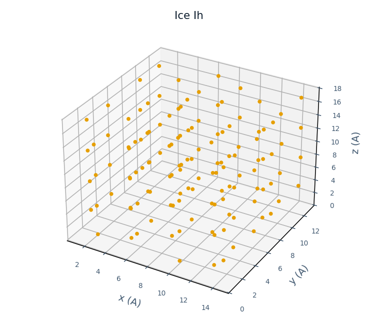
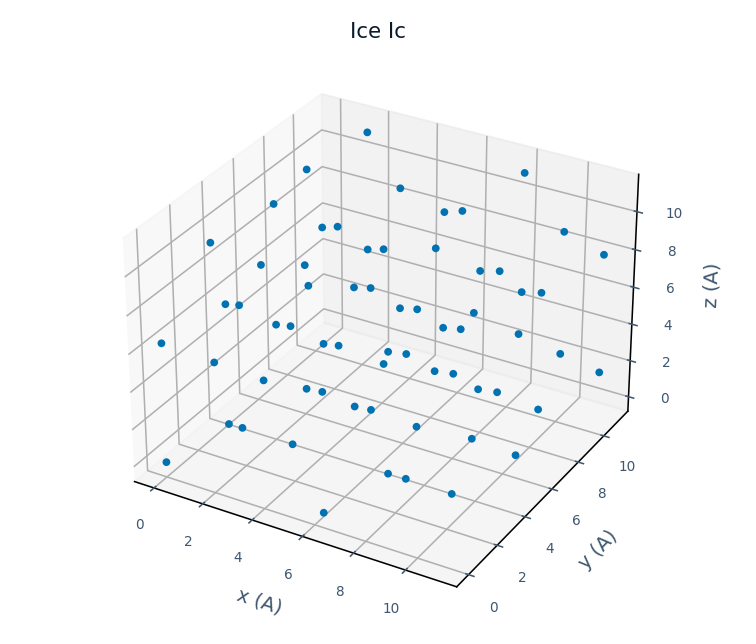
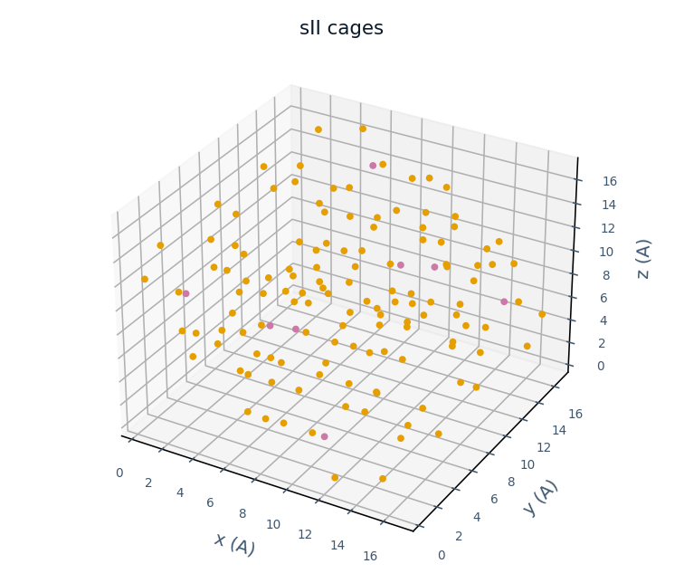
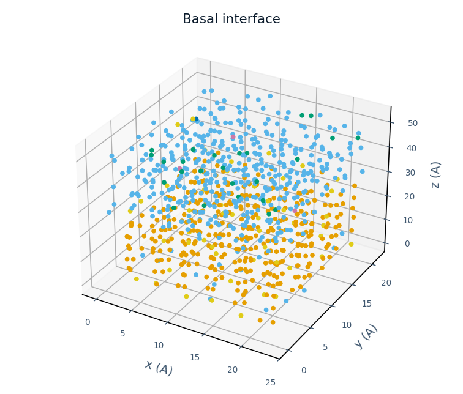
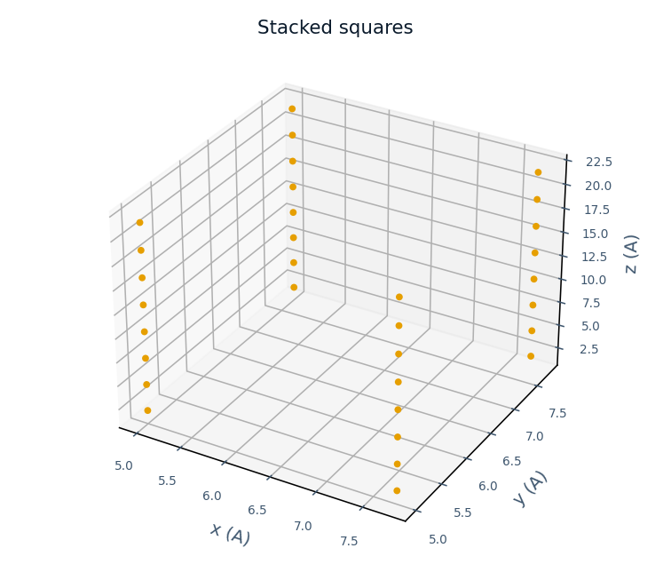
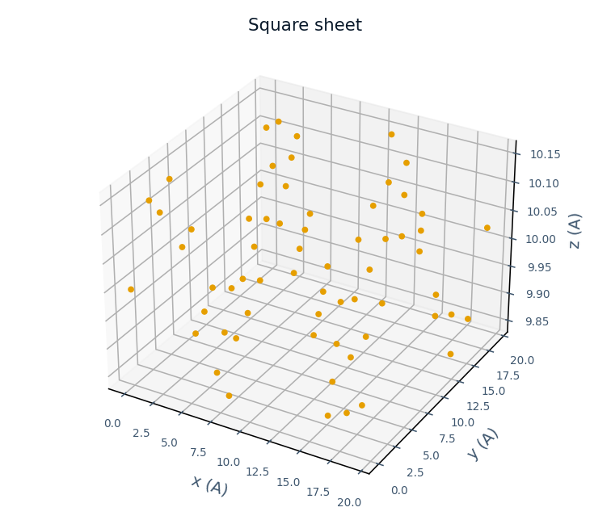

# Structure gallery

Each picture is the coordinates of a tutorial input, coloured by a label the engine computed for that file. Ice Ih and ice Ic are CHILL+. The sII cell is coloured by cage: dodecahedron vertices in one colour, the larger cage in another. The interface is CHILL+ along the slab. The nanotube and the sheet are the lattices themselves.

```python
# example
from pathlib import Path

import numpy as np
from dseams.userframe import read

from examples.render import IH, LABEL_COLOUR, scatter

out = Path("docs/images/gallery")


def by_label(frame):
    frame.chill_plus()
    return [LABEL_COLOUR[name] for name in frame._labels]


ih = read("examples/inputs/ice1h.lammpstrj", atom_type=1)
assert ih.chill_plus()["hexagonal"] == 128
scatter(out / "ice-ih.png", ih.positions, by_label(ih), "Ice Ih")

ic = read("examples/inputs/ice_ic.lammpstrj", atom_type=1)
assert ic.chill_plus()["cubic"] == 64
scatter(out / "ice-ic.png", ic.positions, by_label(ic), "Ice Ic")

tube = read("examples/inputs/nanotube.lammpstrj", atom_type=1)
scatter(out / "nanotube.png", tube.positions, [IH] * tube.n_atoms, "Stacked squares")

sheet = read("examples/inputs/monolayer.lammpstrj", atom_type=1)
scatter(out / "monolayer.png", sheet.positions, [IH] * sheet.n_atoms, "Square sheet")

face = read("examples/inputs/interface_f0.lammpstrj", atom_type=1)
assert face.chill_plus()["hexagonal"] == 352
scatter(out / "interface.png", face.positions, by_label(face), "Basal interface")

sii = read("examples/inputs/genice_sII.lammpstrj", atom_type=1)
paint = ["water"] * sii.n_atoms
for spec, name in (("512", "clathrate"), ("51264", "hexagonal")):
    found = sii.cages_by_signature(spec, edge="none")
    for cage in found:
        for vertex in cage["vertices"]:
            assert 0 <= vertex < sii.n_atoms
            paint[vertex] = name
assert paint.count("clathrate") > 0
scatter(out / "sii.png", sii.positions, [LABEL_COLOUR[name] for name in paint], "sII cages")
print("gallery", out)
```

## Ice Ih

128 oxygens, all hexagonal.



## Ice Ic

64 oxygens on a diamond lattice, all cubic.



## sII

One cell. Dodecahedra (`512`) in clathrate pink, the `51264` cages in hexagonal gold.



## Basal interface

864 oxygens. Gold is hexagonal ice, blue is water, and the other CHILL+ labels sit on the front.



## Stacked squares

32 oxygens, eight squares. The prism census is in [Ice nanotubes](../tutorials/nanotubes.md).



## Square sheet

64 oxygens. The ring census is in [Monolayer rings](../tutorials/monolayer.md).



The colour key matches the series elsewhere: hexagonal `#e69f00`, water `#56b4e9`, interfacial `#e0cc18`, cubic `#0072b2`, clathrate `#cc79a7`, interfacial clathrate `#009e73`.
