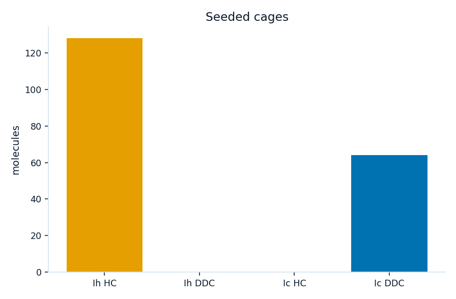
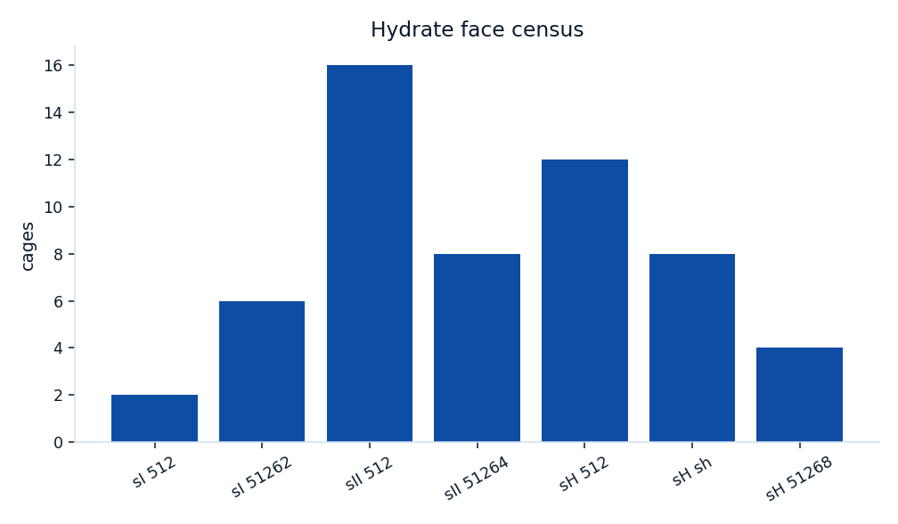

# Bulk ice and hydrate cages

Ice Ih is a stack of hexagonal cages. Ice Ic is a network of double-diamond cages. A clathrate hydrate is a different polyhedron: pentagonal dodecahedra, and larger cages whose faces are pentagons and hexagons. This tutorial asks the topological criterion for both.

The inputs are small and public.

- `examples/inputs/ice1h.lammpstrj`: 128 oxygens of a 2x2x2 ice Ih cell.
- `examples/inputs/ice_ic.lammpstrj`: 64 oxygens on a 2x2x2 diamond lattice, cube edge 6.358 angstrom.
- `examples/inputs/genice_sI.lammpstrj`, `genice_sII.lammpstrj`, `genice_sH.lammpstrj`: one unit cell of each empty hydrate.

A molecule in a finished hexagonal cage (HC) is ice Ih. A molecule in a finished double-diamond cage (DDC) is ice Ic. Hydrate cages are named by their face census. `512` is twelve pentagons. `51262` is twelve pentagons and two hexagons. `51264` is the larger sII cage. `sh` and `51268` are the medium and large sH cages.

Run the blocks from the repository root.

=== "Python"

    ```python
    # example
    from pathlib import Path

    from dseams.userframe import read

    from examples.render import IC, IH, panel, save

    inp = Path("examples/inputs")
    fig = Path("docs/images/figures")

    ih = read(inp / "ice1h.lammpstrj", atom_type=1)
    ic = read(inp / "ice_ic.lammpstrj", atom_type=1)
    assert ih.chill_plus()["hexagonal"] == 128
    assert ih.cages().n_ih == 128 and ih.cages().n_ic == 0
    assert ic.chill_plus()["cubic"] == 64
    assert ic.cages().n_ih == 0 and ic.cages().n_ic == 64
    print("Ih", ih.chill_plus(), ih.cages())
    print("Ic", ic.chill_plus(), ic.cages())

    census = {
        "sI 512": (2, 40),
        "sI 51262": (6, 46),
        "sII 512": (16, 136),
        "sII 51264": (8, 128),
        "sH 512": (12, 136),
        "sH sh": (8, 112),
        "sH 51268": (4, 120),
    }
    files = {
        "sI": inp / "genice_sI.lammpstrj",
        "sII": inp / "genice_sII.lammpstrj",
        "sH": inp / "genice_sH.lammpstrj",
    }
    frames = {name: read(path, atom_type=1) for name, path in files.items()}
    measured = []
    for label, (n_cages, n_atoms) in census.items():
        guest, spec = label.split()
        found = frames[guest].cages_by_signature(spec, edge="none")
        assert len(found) == n_cages
        assert found.n_atoms == n_atoms
        measured.append(len(found))
        print(label, len(found), found.n_atoms)

    chart, ax = panel()
    ax.bar(["Ih HC", "Ih DDC", "Ic HC", "Ic DDC"], [128, 0, 0, 64], color=[IH, IC, IH, IC])
    ax.set_ylabel("molecules")
    ax.set_title("Seeded cages")
    save(chart, fig / "bulk-cages.png")

    chart, ax = panel(7.2, 4.2)
    ax.bar(list(census), measured, color="#0e4da4")
    ax.set_ylabel("cages")
    ax.set_title("Hydrate face census")
    ax.tick_params(axis="x", rotation=30)
    save(chart, fig / "hydrate-census.png")
    ```

=== "Julia"

    ```julia
    # example
    using Dseams

    ih = read_frame("examples/inputs/ice1h.lammpstrj"; type=1)
    ice = chill_plus(ih)
    found = cages(ih)
    @assert ice.counts["hexagonal"] == 128
    @assert found.n_ih == 128 && found.n_ic == 0

    ic = read_frame("examples/inputs/ice_ic.lammpstrj"; type=1)
    cubic = chill_plus(ic)
    ic_cages = cages(ic)
    @assert cubic.counts["cubic"] == 64
    @assert ic_cages.n_ic == 64 && ic_cages.n_ih == 0

    si = read_frame("examples/inputs/genice_sI.lammpstrj"; type=1)
    small = signature_cages(si, "512")
    large = signature_cages(si, "51262")
    @assert small.cages == 2 && small.atoms == 40
    @assert large.cages == 6 && large.atoms == 46
    println(ice.counts["hexagonal"], " ", ic_cages.n_ic, " ", small.cages, " ", large.cages)
    ```

=== "Rust"

    ```rust
    // example
    fn main() {
        let mut system = seams::System::new().expect("system");
        system
            .read("examples/inputs/ice1h.lammpstrj", 1, 1)
            .expect("read");
        let ice = system
            .chill_plus(&seams::ChillOptions::default())
            .expect("chill");
        let cages = system.cages(&seams::CageOptions::default()).expect("cages");
        let counts = cages.counts().expect("counts");
        assert_eq!(ice.counts[1], 128);
        assert_eq!(counts.hexagonal, 128);

        system
            .read("examples/inputs/ice_ic.lammpstrj", 1, 1)
            .expect("read");
        let ice = system
            .chill_plus(&seams::ChillOptions::default())
            .expect("chill");
        let cages = system.cages(&seams::CageOptions::default()).expect("cages");
        let counts = cages.counts().expect("counts");
        assert_eq!(ice.counts[0], 64);
        assert_eq!(counts.cubic, 64);

        system
            .read("examples/inputs/genice_sII.lammpstrj", 1, 1)
            .expect("read");
        let small = system
            .signature_cages(&seams::SignatureOptions {
                spec: "512".into(),
                ..Default::default()
            })
            .expect("512");
        let large = system
            .signature_cages(&seams::SignatureOptions {
                spec: "51264".into(),
                ..Default::default()
            })
            .expect("51264");
        assert_eq!((small.cages, small.atoms), (16, 136));
        assert_eq!((large.cages, large.atoms), (8, 128));
        println!("sII {} {}", small.cages, large.cages);
    }
    ```

=== "CLI"

    ```bash
    # example
    set -euo pipefail
    seams chill-plus examples/inputs/ice1h.lammpstrj --type 1 --cutoff 3.5 | tee /tmp/ih.txt
    grep -q "hexagonal 128" /tmp/ih.txt
    seams cages examples/inputs/ice1h.lammpstrj --type 1 --cutoff 3.5 | tee /tmp/ih-cages.txt
    grep -q "hexagonal 128" /tmp/ih-cages.txt
    seams chill-plus examples/inputs/ice_ic.lammpstrj --type 1 --cutoff 3.5 | tee /tmp/ic.txt
    grep -q "cubic 64" /tmp/ic.txt
    seams cages examples/inputs/genice_sI.lammpstrj --type 1 --graph cutoff --signature 512+51262 --cage-edge none | tee /tmp/si.txt
    grep -q "signature 5:12 cages 2 atoms 40" /tmp/si.txt
    grep -q "signature 5:12,6:2 cages 6 atoms 46" /tmp/si.txt
    seams cages examples/inputs/genice_sII.lammpstrj --type 1 --graph cutoff --signature 512+51264 --cage-edge none | tee /tmp/sii.txt
    grep -q "signature 5:12 cages 16 atoms 136" /tmp/sii.txt
    grep -q "signature 5:12,6:4 cages 8 atoms 128" /tmp/sii.txt
    seams cages examples/inputs/genice_sH.lammpstrj --type 1 --graph cutoff --signature 512+sh+51268 --cage-edge none | tee /tmp/sh.txt
    grep -q "signature 5:12 cages 12 atoms 136" /tmp/sh.txt
    grep -q "signature 4:3,5:6,6:3 cages 8 atoms 112" /tmp/sh.txt
    grep -q "signature 5:12,6:8 cages 4 atoms 120" /tmp/sh.txt
    ```





Ice Ih is entirely hexagonal, both by CHILL+ and by the cage score. Ice Ic is entirely cubic. One sII cell holds 16 dodecahedra and 8 hexakaidecahedra. The sH cell is triclinic. Its tilt is the subject of [Triclinic cells](../howto/triclinic.md).

The renders of these frames are in the [gallery](../reference/gallery.md). The cage shapes are explained in [Prisms and cages](../explanation/cages.md).
