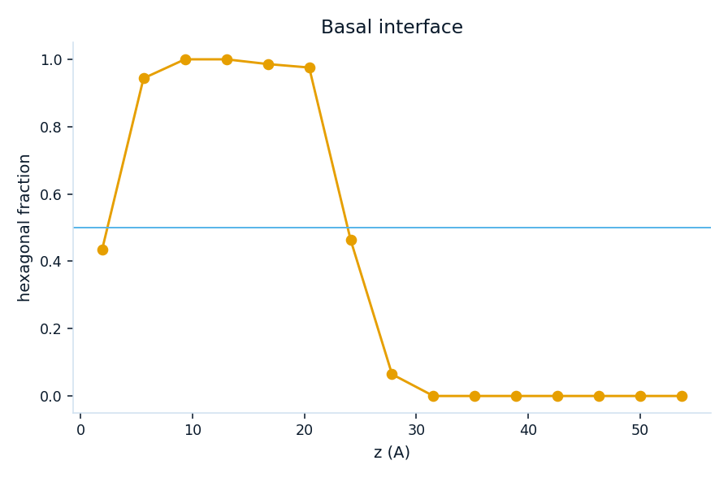

# Ice/water interface

A basal interface is a slab of ice against a slab of liquid, in one frame. CHILL+ labels every oxygen. Binning those labels along the long axis shows where the crystal gives way to the liquid.

The frame is `examples/inputs/interface_f0.lammpstrj`: 864 oxygens in a box about 23 by 22 by 53 angstrom. The long edge is z.

=== "Python"

    ```python
    # example
    from pathlib import Path

    import numpy as np
    from dseams.userframe import read

    from examples.render import IH, WATER, panel, save

    frame = read("examples/inputs/interface_f0.lammpstrj", atom_type=1)
    labels = frame.chill_plus()
    assert labels["hexagonal"] == 352
    assert labels["water"] == 434
    assert labels["interfacial"] == 49
    assert labels["cubic"] == 1
    names = frame._labels
    z = frame.positions[:, 2]
    crystal = np.array([name == "hexagonal" for name in names])
    edges = np.arange(z.min(), z.max() + 3.7, 3.7)
    centres, fractions = [], []
    for lo, hi in zip(edges[:-1], edges[1:]):
        mask = (z >= lo) & (z < hi)
        if mask.sum() == 0:
            continue
        centres.append(0.5 * (lo + hi))
        fractions.append(crystal[mask].mean())
    # Slab centre where the hexagonal fraction falls through one half,
    # after the crystal plateau.
    front = next(c for c, frac in zip(centres, fractions) if c > 15.0 and frac < 0.5)
    assert 22.0 < front < 26.0
    print(labels)
    print("front", round(front, 2))

    chart, ax = panel()
    ax.plot(centres, fractions, color=IH, marker="o")
    ax.axhline(0.5, color=WATER, linewidth=1)
    ax.set_xlabel("z (A)")
    ax.set_ylabel("hexagonal fraction")
    ax.set_title("Basal interface")
    save(chart, Path("docs/images/figures/interface.png"))
    ```

=== "Julia"

    ```julia
    # example
    using Dseams

    frame = read_frame("examples/inputs/interface_f0.lammpstrj"; type=1)
    ice = chill_plus(frame)
    @assert ice.counts["hexagonal"] == 352
    @assert ice.counts["water"] == 434
    @assert ice.counts["interfacial"] == 49
    @assert ice.counts["cubic"] == 1
    println(ice.counts["hexagonal"], " ", ice.counts["water"])
    ```

=== "Rust"

    ```rust
    // example
    fn main() {
        let mut system = seams::System::new().expect("system");
        system
            .read("examples/inputs/interface_f0.lammpstrj", 1, 1)
            .expect("read");
        let ice = system
            .chill_plus(&seams::ChillOptions::default())
            .expect("chill");
        assert_eq!(ice.counts[1], 352);
        assert_eq!(ice.counts[2], 434);
        assert_eq!(ice.counts[3], 49);
        assert_eq!(ice.counts[0], 1);
        println!("hexagonal {} water {}", ice.counts[1], ice.counts[2]);
    }
    ```

=== "CLI"

    ```bash
    # example
    set -euo pipefail
    seams chill-plus examples/inputs/interface_f0.lammpstrj --type 1 --cutoff 3.5 --layers --axis 2 | tee /tmp/interface.txt
    grep -q "hexagonal 352" /tmp/interface.txt
    grep -q "water 434" /tmp/interface.txt
    grep -q "stack HHHHHHHH....C." /tmp/interface.txt
    ```



The published CHILL+ rule finds 352 hexagonal molecules, 434 waters, 49 interfacial molecules, and a single cubic molecule. `--layers` prints the basal stack `HHHHHHHH....C.`: eight hexagonal slabs, a gap, and one cubic layer. The hexagonal fraction along z stays near one through that slab and falls through one half in the next 3.7 angstrom bin. A coloured render is in the [gallery](../reference/gallery.md).
