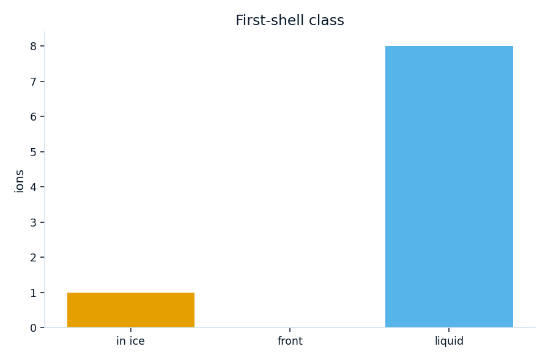

# Ions

An ion is not a vertex of the hydrogen-bond network. The cage assignment runs on the water. Each ion is then classed by the water in its first shell: ice when every neighbour in that shell is ice, liquid when none of it is, and front otherwise.

`examples/inputs/nacl_front.lammpstrj` is a basal ice slab with sodium and chloride. Water is type 1. The ions are types 3 and 4. The shell radius used here is 3.5 angstrom.

=== "Python"

    ```python
    # example
    from pathlib import Path

    import pydseams as ds

    from examples.render import IC, IH, WATER, panel, save

    frame = ds.read("examples/inputs/nacl_front.lammpstrj", atom_type=1, all_atoms=True)
    env = frame.ion_environment((3, 4), ring_adjacent=True, cutoff=3.5)
    assert (env.nIce, env.nFront, env.nLiquid) == (1, 0, 8)
    print(env.nIce, env.nFront, env.nLiquid)

    chart, ax = panel()
    ax.bar(["in ice", "front", "liquid"], [env.nIce, env.nFront, env.nLiquid], color=[IH, IC, WATER])
    ax.set_ylabel("ions")
    ax.set_title("First-shell class")
    save(chart, Path("docs/images/figures/ions.png"))
    ```

=== "CLI"

    ```bash
    # example
    set -euo pipefail
    seams ions examples/inputs/nacl_front.lammpstrj --type 1 --ion-types 3,4 --ion-cutoff 3.5 --complete | tee /tmp/ions.txt
    grep -q "ions 9" /tmp/ions.txt
    grep -q "in-ice 1" /tmp/ions.txt
    grep -q "front 0" /tmp/ions.txt
    grep -q "liquid 8" /tmp/ions.txt
    ```



Nine ions sit in the frame. One is buried in ice. Eight see only liquid water. None sits on the front at this cutoff. `seams cn --ions` is a different command: it is a coordination number on an ion site table, and it needs `--site`.

The same split is what `DSEAMS_CAGES` reports as `nionice`, `nionfront`, and `nionliq` when you pass `IONS`. See [On the fly with PLUMED](plumed.md).
