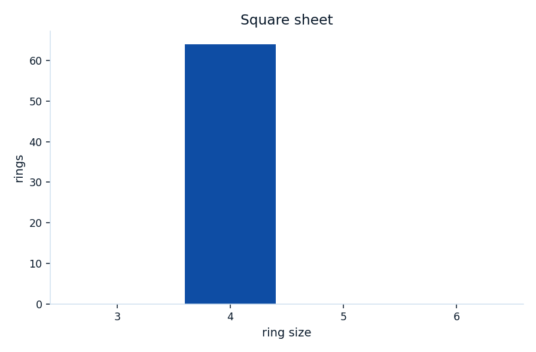

# Monolayer rings

A flat sheet of water is a two-dimensional network. The ice is the primitive rings that tile it. Square ice is a tiling by four-membered rings.

`examples/inputs/monolayer.lammpstrj` is an 8 by 8 square lattice, spacing 2.75 angstrom, 64 oxygens. Each site is shifted along z by `0.15 sin(i)` angstrom so the sheet has a thickness. The cell in the plane is 22 angstrom on a side. Pass that area when you ask for coverage.

=== "Python"

    ```python
    # example
    import tempfile
    from pathlib import Path

    from dseams.userframe import read

    from examples.render import panel, save

    frame = read("examples/inputs/monolayer.lammpstrj", atom_type=1)
    rings = frame.monolayer_rings(tempfile.mkdtemp(), sheet_area=22.0 * 22.0, max_depth=6)
    assert rings[4]["count"] == 64
    assert rings[4]["coverage_xy"] == 100.0
    assert rings[3]["count"] == rings[5]["count"] == rings[6]["count"] == 0
    print(rings)

    chart, ax = panel()
    sizes = [3, 4, 5, 6]
    ax.bar([str(n) for n in sizes], [rings[n]["count"] for n in sizes], color="#0e4da4")
    ax.set_xlabel("ring size")
    ax.set_ylabel("rings")
    ax.set_title("Square sheet")
    save(chart, Path("docs/images/figures/monolayer-rings.png"))
    ```

=== "Julia"

    ```julia
    # example
    using Dseams

    sys = System()
    seams_system_read(sys, "examples/inputs/monolayer.lammpstrj", 1, 1)
    counts = seams_monolayer(sys; max_depth=6, sheet_area=22.0 * 22.0)
    @assert counts[5] == 64
    println(counts)
    ```

=== "Rust"

    ```rust
    // example
    fn main() {
        let mut system = seams::System::new().expect("system");
        system
            .read("examples/inputs/monolayer.lammpstrj", 1, 1)
            .expect("read");
        let counts = system
            .monolayer(&seams::SheetOptions {
                sheet_area: 22.0 * 22.0,
                max_size: 6,
                ..Default::default()
            })
            .expect("sheet");
        assert_eq!(counts[4], 64);
        println!("four-rings {}", counts[4]);
    }
    ```

=== "CLI"

    ```bash
    # example
    set -euo pipefail
    seams rings examples/inputs/monolayer.lammpstrj --type 1 --cutoff 3.5 --max-ring 6 | tee /tmp/sheet.txt
    grep -q "rings 64" /tmp/sheet.txt
    grep -q "^4 64$" /tmp/sheet.txt
    ```



Every primitive ring is a square, and those squares cover the sheet. The in-plane pair histogram of this file is in [Radial distributions](rdf.md). Primitive rings are explained in [Primitive rings](../explanation/rings.md).
