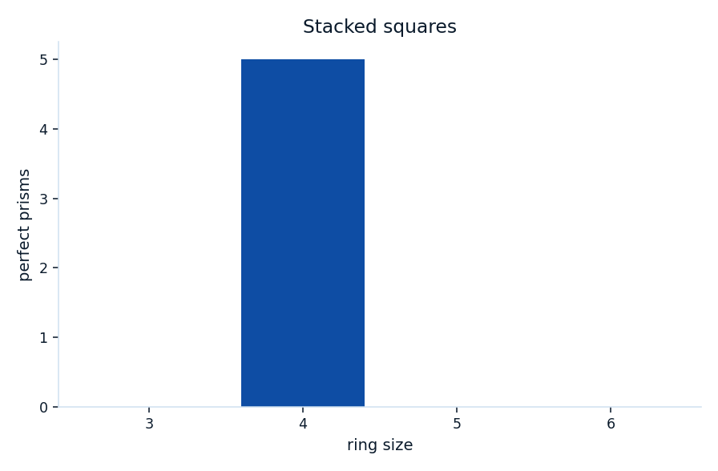

# Ice nanotubes

Quasi-one-dimensional ice is a stack of rings. When two rings of the same size sit on a common axis and the bonds between them close a prism, d-SEAMS counts a prism block. Squares give tetragonal prisms, the block inside a square ice nanotube.

The input `examples/inputs/nanotube.lammpstrj` is eight squares of side 2.75 angstrom, stacked every 2.80 angstrom: 32 oxygens. The search reports perfect and imperfect prisms of size 3, 4, 5, and 6.

=== "Python"

    ```python
    # example
    import tempfile
    from pathlib import Path

    from dseams.userframe import read

    from examples.render import panel, save

    frame = read("examples/inputs/nanotube.lammpstrj", atom_type=1)
    rows = frame.find_prisms(tempfile.mkdtemp())
    by_size = {row["size"]: row["perfect"] for row in rows}
    assert by_size[4] == 5
    assert by_size[3] == by_size[5] == by_size[6] == 0
    print(rows)

    chart, ax = panel()
    ax.bar(["3", "4", "5", "6"], [by_size[n] for n in (3, 4, 5, 6)], color="#0e4da4")
    ax.set_xlabel("ring size")
    ax.set_ylabel("perfect prisms")
    ax.set_title("Stacked squares")
    save(chart, Path("docs/images/figures/prisms.png"))
    ```

=== "Julia"

    ```julia
    # example
    using Dseams

    sys = System()
    seams_system_read(sys, "examples/inputs/nanotube.lammpstrj", 1, 1)
    perfect = seams_prisms(sys)
    # Index 5 is size 4. Index 7 is size 6.
    @assert perfect[5] == 5
    @assert perfect[4] == 0 && perfect[6] == 0 && perfect[7] == 0
    println(perfect)
    ```

=== "Rust"

    ```rust
    // example
    fn main() {
        let mut system = seams::System::new().expect("system");
        system
            .read("examples/inputs/nanotube.lammpstrj", 1, 1)
            .expect("read");
        let prisms = system
            .prisms(&seams::PrismOptions::default())
            .expect("prisms");
        assert_eq!(prisms.perfect[4], 5);
        assert_eq!(prisms.perfect[3], 0);
        assert_eq!(prisms.perfect[5], 0);
        assert_eq!(prisms.perfect[6], 0);
        println!("tetragonal {}", prisms.perfect[4]);
    }
    ```

=== "CLI"

    ```bash
    # example
    set -euo pipefail
    seams prisms examples/inputs/nanotube.lammpstrj --type 1 --cutoff 3.5 | tee /tmp/prisms.txt
    grep -q "size 4 perfect 5 imperfect 0" /tmp/prisms.txt
    grep -q "perfect 5 imperfect 0" /tmp/prisms.txt
    ```



The engine keeps five perfect tetragonal prisms. Every other size is empty, and there are no imperfect blocks. A render of the stack is in the [gallery](../reference/gallery.md). Why a prism is the one-dimensional ice unit is in [Prisms and cages](../explanation/cages.md).
