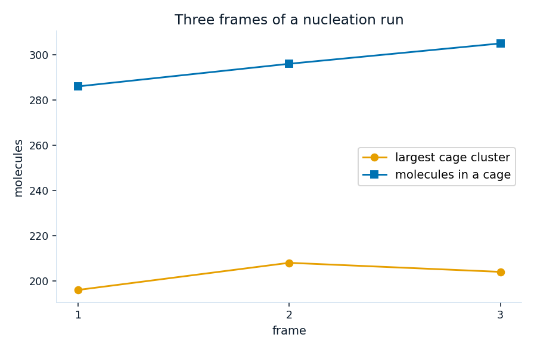

# Nucleation

A nucleus is the largest cluster of ice-like molecules, and the thing you track is how that cluster changes from frame to frame. q6-bar of the whole frame moves only a little while the cluster is still small. The cluster size is the sharper coordinate.

`examples/inputs/nucleation_three.lammpstrj` holds three frames of 4096 sites. `seams cluster` is a different number: it is the largest connected piece of every loaded atom, which on this network is almost the whole box. The nucleus is the largest connected set of molecules that sit in a cage.

=== "Python"

    ```python
    # example
    from pathlib import Path

    import numpy as np
    import pydseams as ds
    from dseams.userframe import read
    from pydseams import Trajectory
    from pydseams.features import IceFeaturizer

    from examples.render import IC, IH, panel, save

    path = "examples/inputs/nucleation_three.lammpstrj"
    means = []
    for number in (1, 2, 3):
        frame = read(path, frame=number, atom_type=1)
        bar = frame.steinhardt(6)["ql_bar"]
        means.append(sum(bar) / len(bar))
    assert abs(means[0] - 0.26063) < 5e-5

    traj = Trajectory(path, frame=1, atom_type=1, cutoff=3.5)
    features, _states = IceFeaturizer(traj).transform()
    names = IceFeaturizer(traj).feature_names
    n_max = features[:, names.index("n_max")]
    n_ice = features[:, names.index("n_ice")]
    assert list(n_max) == [196.0, 208.0, 204.0]
    print("q6bar", [round(v, 6) for v in means])
    print("n_ice", n_ice.tolist())
    print("n_max", n_max.tolist())

    chart, ax = panel()
    frames = np.arange(1, 4)
    ax.plot(frames, n_max, color=IH, marker="o", label="largest cage cluster")
    ax.plot(frames, n_ice, color=IC, marker="s", label="molecules in a cage")
    ax.set_xlabel("frame")
    ax.set_xticks(frames)
    ax.set_ylabel("molecules")
    ax.set_title("Three frames of a nucleation run")
    ax.legend()
    save(chart, Path("docs/images/figures/nucleation.png"))
    ```

=== "Julia"

    ```julia
    # example
    using Dseams

    path = "examples/inputs/nucleation_three.lammpstrj"
    means = Float64[]
    for number in 1:3
        frame = read_frame(path; frame=number, type=1)
        order = q4_q6(frame)
        push!(means, sum(order.q6bar) / length(order.q6bar))
    end
    @assert abs(means[1] - 0.26063) < 5e-4
    println(means)
    ```

=== "Rust"

    ```rust
    // example
    fn main() {
        let mut system = seams::System::new().expect("system");
        for frame in 1..=3 {
            system
                .read("examples/inputs/nucleation_three.lammpstrj", frame, 1)
                .expect("read");
            let summary = system
                .q6bar(&seams::Q6BarOptions::default())
                .expect("q6bar");
            println!("frame {frame} q6bar {}", summary.mean);
            if frame == 1 {
                assert!((summary.mean - 0.26063).abs() < 5e-5);
            }
        }
    }
    ```

=== "CLI"

    ```bash
    # example
    set -euo pipefail
    seams steinhardt examples/inputs/nucleation_three.lammpstrj --type 1 --frame 1 --last 3 --l 6 | tee /tmp/nuc-q.txt
    grep -q "q6bar 0.26063" /tmp/nuc-q.txt
    seams cages examples/inputs/nucleation_three.lammpstrj --type 1 --frame 1 --last 3 | tee /tmp/nuc-cages.txt
    seams cluster examples/inputs/nucleation_three.lammpstrj --type 1 --frame 1 | tee /tmp/nuc-all.txt
    grep -q "largest 4095" /tmp/nuc-all.txt
    ```



Mean q6-bar on the first frame is 0.26063. Across the three frames it barely moves. The largest cage cluster is 196, then 208, then 204 molecules. The largest component of every atom is 4095, which is the liquid network, not the nucleus.

Threading of this same file is in [Large systems](../howto/threading.md). The PLUMED action reports this cluster as `nmax` in [On the fly with PLUMED](plumed.md).
