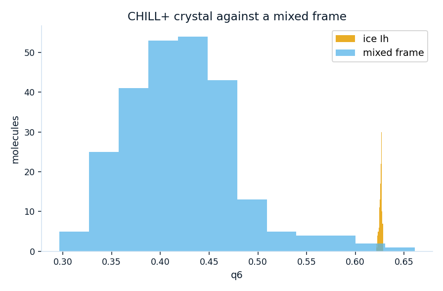

# CHILL+ and q6

Two numbers are often quoted for the same oxygen. CHILL+ is a label. It looks at the staggered and eclipsed bonds among the four nearest neighbours and calls the molecule cubic, hexagonal, interfacial, clathrate, interfacial clathrate, or water. q6 is a Steinhardt parameter: how directional the neighbour shell is. The Lechner-Dellago average, q6-bar, mixes that number with the neighbours' own q6.

They answer different questions. A crystal of ice Ih scores high on both. A disordered hydrogen-bond network scores as water under CHILL+ and sits at a lower q6.

The crystal is `examples/inputs/ice1h.lammpstrj`. The disordered frame is `examples/inputs/exampleTraj.lammpstrj`, 250 oxygens of type 2.

=== "Python"

    ```python
    # example
    from pathlib import Path

    from dseams.userframe import read

    from examples.render import IH, WATER, panel, save

    crystal = read("examples/inputs/ice1h.lammpstrj", atom_type=1)
    mixed = read("examples/inputs/exampleTraj.lammpstrj", atom_type=2)
    labels = crystal.chill_plus()
    other = mixed.chill_plus()
    assert labels["hexagonal"] == 128
    assert other["interClathrate"] == 9 and other["water"] == 241
    q6 = crystal.steinhardt(6)["ql"]
    q6_mixed = mixed.steinhardt(6)["ql"]
    mean = sum(q6) / len(q6)
    mean_mixed = sum(q6_mixed) / len(q6_mixed)
    assert abs(mean - 0.625855) < 1e-4
    assert mean_mixed < mean
    print(labels, mean)
    print(other, mean_mixed)

    chart, ax = panel()
    ax.hist(q6, bins=12, color=IH, alpha=0.85, label="ice Ih")
    ax.hist(q6_mixed, bins=12, color=WATER, alpha=0.75, label="mixed frame")
    ax.set_xlabel("q6")
    ax.set_ylabel("molecules")
    ax.set_title("CHILL+ crystal against a mixed frame")
    ax.legend()
    save(chart, Path("docs/images/figures/q6.png"))
    ```

=== "Julia"

    ```julia
    # example
    using Dseams

    crystal = read_frame("examples/inputs/ice1h.lammpstrj"; type=1)
    ice = chill_plus(crystal)
    order = q4_q6(crystal)
    mean = sum(order.q6) / length(order.q6)
    @assert ice.counts["hexagonal"] == 128
    @assert abs(mean - 0.625855) < 1e-4

    mixed = read_frame("examples/inputs/exampleTraj.lammpstrj"; type=2)
    other = chill_plus(mixed)
    @assert other.counts["interClathrate"] == 9
    @assert other.counts["water"] == 241
    println(mean, " ", other.counts["water"])
    ```

=== "Rust"

    ```rust
    // example
    fn main() {
        let mut system = seams::System::new().expect("system");
        system
            .read("examples/inputs/ice1h.lammpstrj", 1, 1)
            .expect("read");
        let ice = system
            .chill_plus(&seams::ChillOptions::default())
            .expect("chill");
        let q6 = system.q4q6(3.5).expect("q6");
        let mean = q6.q6.iter().sum::<f64>() / q6.q6.len() as f64;
        assert_eq!(ice.counts[1], 128);
        assert!((mean - 0.625855).abs() < 1e-4);

        system
            .read("examples/inputs/exampleTraj.lammpstrj", 1, 2)
            .expect("read");
        let other = system
            .chill_plus(&seams::ChillOptions::default())
            .expect("chill");
        assert_eq!(other.counts[5], 9);
        assert_eq!(other.counts[2], 241);
        println!("q6 {mean} water {}", other.counts[2]);
    }
    ```

=== "CLI"

    ```bash
    # example
    set -euo pipefail
    seams chill-plus examples/inputs/ice1h.lammpstrj --type 1 --cutoff 3.5 | tee /tmp/chill-ih.txt
    grep -q "hexagonal 128" /tmp/chill-ih.txt
    seams steinhardt examples/inputs/ice1h.lammpstrj --type 1 --cutoff 3.5 --l 6 | tee /tmp/q6.txt
    grep -q "q6 0.625855" /tmp/q6.txt
    seams chill-plus examples/inputs/exampleTraj.lammpstrj --type 2 --cutoff 3.5 | tee /tmp/chill-mix.txt
    grep -q "interClathrate 9" /tmp/chill-mix.txt
    grep -q "water 241" /tmp/chill-mix.txt
    ```



On the ice Ih cell every molecule is hexagonal and the mean q6 is 0.625855. On the mixed frame CHILL+ finds 9 interfacial-clathrate molecules and 241 waters, and the q6 distribution sits to the left of the crystal. How the two criteria relate is in [Two ways to name ice](../explanation/criteria.md). The neighbour cutoff that feeds both is in [Choose a cutoff](../howto/cutoff.md).
