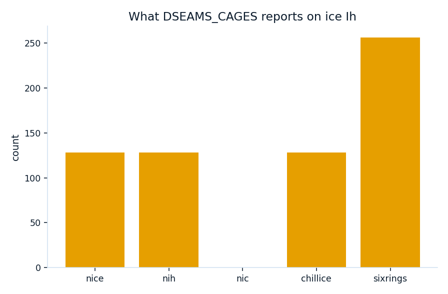

# On the fly with PLUMED

`DSEAMS_CAGES` is a PLUMED action. On each step it builds the four-nearest-neighbour graphs, the primitive six-rings, and the seeded cage assignment, and it reports integer counts. The counts have no derivatives. A run prints them, and a committor uses one of them as a basin coordinate.

The book is [plumed.dseams.info](https://plumed.dseams.info/). The same counts, on the ice Ih cell, are what the blocks below compute.

On `examples/inputs/ice1h.lammpstrj` every oxygen is in a hexagonal cage and in one cluster, and CHILL+ calls every oxygen hexagonal. The action's names for those numbers are `nice`, `nmax`, `nih`, and `chillice`. `nic` is the double-diamond count, which is zero. There are 256 primitive six-rings, which the action reports as `sixrings`.

=== "Python"

    ```python
    # example
    from pathlib import Path

    from dseams.userframe import read

    from examples.render import IH, panel, save

    frame = read("examples/inputs/ice1h.lammpstrj", atom_type=1)
    cages = frame.cages()
    labels = frame.chill_plus()
    rings = frame.ring_census(max_size=6)
    nice = cages.n_ih + cages.n_ic - cages.n_both
    assert (nice, cages.n_ih, cages.n_ic) == (128, 128, 0)
    assert labels["hexagonal"] == 128
    assert rings[6] == 256

    text = """\
    LOAD FILE=./libdseams_plumed.so
    ice: DSEAMS_CAGES ATOMS=1-128 CUTOFF=3.5 COMPLETE
    PRINT ARG=ice.nice,ice.nmax,ice.nic,ice.nih,ice.chillice,ice.sixrings STRIDE=1 FILE=ICE
    COMMITTOR ARG=ice.nmax STRIDE=1 BASIN_LL1=0 BASIN_UL1=20 BASIN_LL2=100 BASIN_UL2=100000
    """
    path = Path("examples/output/ice_ih.dat")
    path.parent.mkdir(parents=True, exist_ok=True)
    path.write_text(text, encoding="utf-8")
    written = path.read_text(encoding="utf-8")
    for key in ("DSEAMS_CAGES", "PRINT", "COMMITTOR", "ice.nice", "ice.nmax", "ice.sixrings"):
        assert key in written
    print("nice", nice, "sixrings", rings[6])

    chart, ax = panel()
    ax.bar(
        ["nice", "nih", "nic", "chillice", "sixrings"],
        [nice, cages.n_ih, cages.n_ic, labels["hexagonal"], rings[6]],
        color=IH,
    )
    ax.set_ylabel("count")
    ax.set_title("What DSEAMS_CAGES reports on ice Ih")
    save(chart, Path("docs/images/figures/plumed.png"))
    ```

=== "CLI"

    ```bash
    # example
    set -euo pipefail
    seams cages examples/inputs/ice1h.lammpstrj --type 1 --cutoff 3.5 | tee /tmp/plumed-cages.txt
    grep -q "hexagonal 128" /tmp/plumed-cages.txt
    seams rings examples/inputs/ice1h.lammpstrj --type 1 --cutoff 3.5 --max-ring 6 | tee /tmp/plumed-rings.txt
    grep -q "^6 256$" /tmp/plumed-rings.txt
    seams chill-plus examples/inputs/ice1h.lammpstrj --type 1 --cutoff 3.5 | tee /tmp/plumed-chill.txt
    grep -q "hexagonal 128" /tmp/plumed-chill.txt
    ```



`PRINT` writes the arguments you name. `COMMITTOR` watches `nmax`, the largest connected cluster of cage molecules, and records which basin the trajectory is in. With `IONS` the same action adds `nionice`, `nionfront`, and `nionliq`, the split in [Ions](ions.md). `SIGNATURE` adds `ncages` for one face census, the split in [Bulk ice and hydrate cages](bulk-ice.md).

The cluster tracked over a nucleation trajectory is [Nucleation](nucleation.md).
