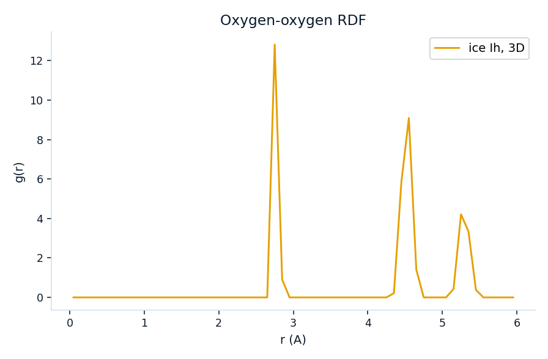
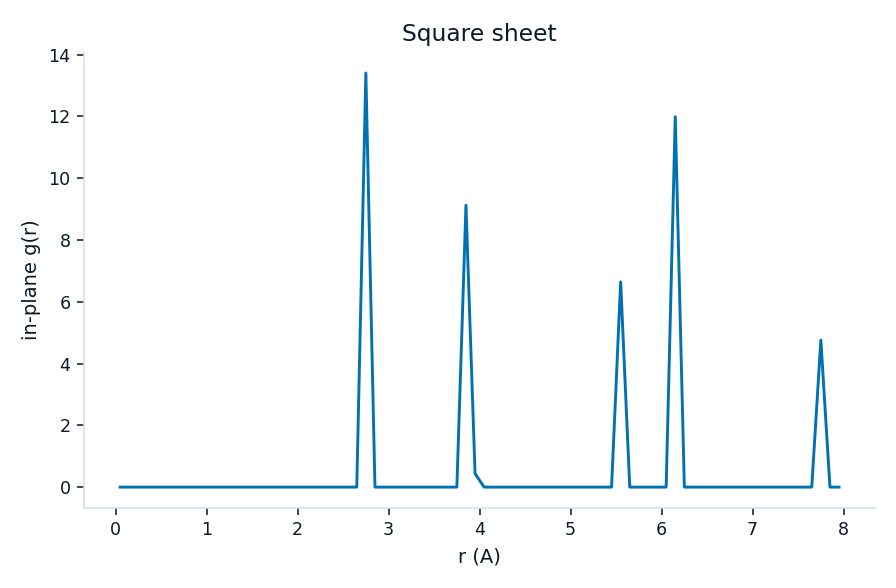

# Radial distributions

The partial radial distribution g(r) is the pair histogram divided by the ideal gas at the same density. For ice the first peak sits on the oxygen-oxygen contact, near 2.75 angstrom.

The in-plane histogram is the same idea after the coordinates are projected onto a plane. It is the distribution you read for a sheet. A sheet with no thickness at all makes the normaliser undefined, so the monolayer file carries a 0.15 angstrom corrugation. Bulk ice Ih has a well-defined three-dimensional g(r) and a well-defined projection.

=== "Python"

    ```python
    # example
    import tempfile
    from pathlib import Path

    import numpy as np
    import pydseams as ds
    from dseams.userframe import read

    from examples.render import IC, IH, panel, save

    bulk = ds.read("examples/inputs/ice1h.lammpstrj", atom_type=1)
    radius, value = bulk.rdf(1, 1, cutoff=6.0, binwidth=0.1)
    radius = np.asarray(radius)
    value = np.asarray(value)
    peak = int(np.argmax(value))
    assert abs(float(radius[peak]) - 2.75) < 1e-6
    print("3D peak", float(radius[peak]), float(value[peak]))

    sheet = read("examples/inputs/monolayer.lammpstrj", atom_type=1)
    r2, g2 = sheet.rdf_2d(tempfile.mkdtemp(), cutoff=8.0, binwidth=0.1)
    r2 = np.asarray(r2)
    g2 = np.asarray(g2, dtype=float)
    assert np.isfinite(g2).all()
    peak2 = int(np.argmax(g2))
    assert abs(float(r2[peak2]) - 2.75) < 0.2
    print("2D peak", float(r2[peak2]), float(g2[peak2]))

    chart, ax = panel()
    ax.plot(radius, value, color=IH, label="ice Ih, 3D")
    ax.set_xlabel("r (A)")
    ax.set_ylabel("g(r)")
    ax.set_title("Oxygen-oxygen RDF")
    ax.legend()
    save(chart, Path("docs/images/figures/rdf.png"))

    chart, ax = panel()
    ax.plot(r2, g2, color=IC)
    ax.set_xlabel("r (A)")
    ax.set_ylabel("in-plane g(r)")
    ax.set_title("Square sheet")
    save(chart, Path("docs/images/figures/rdf2d.png"))
    ```

=== "Julia"

    ```julia
    # example
    using Dseams

    sys = System()
    seams_system_read(sys, "examples/inputs/ice1h.lammpstrj", 1, 1)
    radius, value, volume = seams_rdf(sys; rmax=6.0, bins=60)
    peak = argmax(value)
    @assert abs(radius[peak] - 2.75) < 1e-6
    @assert volume > 0
    println(radius[peak], " ", value[peak])
    ```

=== "Rust"

    ```rust
    // example
    fn main() {
        let mut system = seams::System::new().expect("system");
        system
            .read("examples/inputs/ice1h.lammpstrj", 1, 1)
            .expect("read");
        let g = system
            .rdf(&seams::DistributionOptions {
                rmax: 6.0,
                bins: 60,
                type_i: 1,
                type_j: 1,
            })
            .expect("rdf");
        let peak = g
            .g
            .iter()
            .enumerate()
            .max_by(|a, b| a.1.partial_cmp(b.1).unwrap())
            .unwrap();
        assert!((g.radius[peak.0] - 2.75).abs() < 1e-6);
        println!("peak {} at {}", peak.1, g.radius[peak.0]);
    }
    ```

=== "CLI"

    ```bash
    # example
    set -euo pipefail
    seams rdf examples/inputs/ice1h.lammpstrj --pair-types 1,1 --cutoff 6 --bins 60 | tee /tmp/rdf.txt
    grep -q "2.75" /tmp/rdf.txt
    ```





Both histograms peak on the nearest oxygen-oxygen distance. The three-dimensional curve is the bulk crystal. The in-plane curve is the sheet from [Monolayer rings](monolayer.md). `seams rdf` is the three-dimensional function. The in-plane writer is the library call in the Python block.
